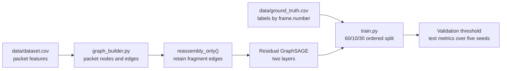

# RG-GNN: Reassembly-Graph Neural Network

PyTorch Geometric implementation of a packet-level classifier for fragmentation-evasion research. It builds graph edges between fragments of the same IP datagram and evaluates a residual GraphSAGE model on labeled packet data.

> Research prototype: the repository does not provide a live IDS, a reproducible benchmark report, or measured production throughput. Treat reported metrics as results to reproduce, not deployment guarantees.

## Pipeline



The graph builder creates both flow-adjacency (`temporal`) and fragment-reassembly (`reassembly`) edges. The proposed model disables the temporal edges before training. Packet features are frame length, fragment offset, more-fragments flag, TCP MSS value, and TCP sequence number. Fragments are grouped by source IP, destination IP, and IP ID, with a five-second grouping window.

## Repository contents

| Path | Purpose |
| --- | --- |
| [`graph_builder.py`](graph_builder.py) | Load the feature CSV and create packet nodes and graph edges. |
| [`th_utils.py`](th_utils.py) | Join labels, split and scale data, train models, and compute metrics. |
| [`train.py`](train.py) | Run standard and feature-noise experiments, then save model weights. |
| [`Data.rar`](Data.rar) | Dataset archive; extract its contents before running the training script. |
| [`CITATION.cff`](CITATION.cff) | Software citation metadata. |

## Reproduce an experiment

1. Create a Python environment with a version supported by the dependencies on your system. Install the packages listed in [`requirements.txt`](requirements.txt):

   ```bash
   python -m pip install -r requirements.txt
   ```

2. Extract `Data.rar`. Arrange the extracted files so that these paths exist relative to the repository root:

   ```text
   data/dataset.csv
   data/ground_truth.csv
   ```

   `th_utils.py` reads these two CSV files directly. The PCAP paths in that module are defined as constants but are not read by `train.py`. If the archive extracts into another directory, move or copy the CSV files to the paths above.

3. Run from the repository root:

   ```bash
   python train.py
   ```

The script performs a 60%/10%/30% split ordered by `frame.number`, fits a `RobustScaler` on the training partition, tunes the decision threshold on validation labels, and prints test metrics across five seeds. It then repeats the experiment with Gaussian feature noise (`std=0.4`) applied to all packet features and writes `proposed_model_final.pth` from the last run. The checkpoint is overwritten on subsequent runs.

## Data and evaluation notes

- `data/dataset.csv` needs the feature columns listed in `graph_builder.py`, source/destination IPs, IP ID, and `frame.number`; `data/ground_truth.csv` needs `frame.number` and `is_evasion`.
- The graph is built before the split. This is a **transductive** evaluation: training can use graph structure that includes validation and test nodes, although the loss uses training labels only. A separate held-out graph is needed to measure inductive generalization.
- The noise experiment perturbs training, validation, and test features. It is not a test-only corruption benchmark.
- No metric table, raw experiment log, dataset-generation script, or live throughput measurement is included here. Publish those artifacts and dataset provenance before presenting a numeric result as independently reproducible.

## Citation and license

Use [`CITATION.cff`](CITATION.cff) to cite the software. See [`LICENSE`](LICENSE) for the MIT license. A paper title in citation metadata is not a link to a published paper; add a DOI or preprint URL when one is available.
